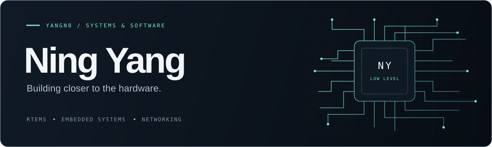

  

  <a href="https://yangn0.github.io/">Notes &amp; writing</a>
  &nbsp; / &nbsp;
  <a href="https://github.com/yangn0?tab=repositories">Repositories</a>
  &nbsp; / &nbsp;
  <a href="https://github.com/yangn0/RTEMS_app">RTEMS experiments</a>

 

### Building closer to the hardware.

I'm **Ning Yang (杨宁)**. My work and experiments center on **RTEMS, embedded systems, and networking** — from board bring-up and peripheral interfaces to network stacks and practical tooling.

I keep code here and write about what I learn on my [technical blog](https://yangn0.github.io/).

 

### Areas of focus

| Real-time systems | Hardware & interfaces | Networks & tooling |
| :--- | :--- | :--- |
| RTEMS · BSP builds | Raspberry Pi · GPIO · SPI · UART | libbsd · lwIP · Python · Shell |

 

### Selected work

| Project | Inside the repository |
| :--- | :--- |
| **[RTEMS applications](https://github.com/yangn0/RTEMS_app)** | Experiments with peripheral interfaces, networking, OpenSSL, and RTEMS services. |
| **[RTEMS development](https://github.com/yangn0/RTEMS_devel)** | Build scripts for BSPs, libbsd, and lwIP, alongside debugging and board-testing utilities. |
| **[Raspberry Pi boot assets](https://github.com/yangn0/rpi-tftp)** | Firmware, device trees, configuration, and application images for Raspberry Pi experiments. |
| **[Technical notes](https://yangn0.github.io/)** | Writing on RTEMS and systems development. |

 

---

  宁静致远 · Stay curious. Build with care.

